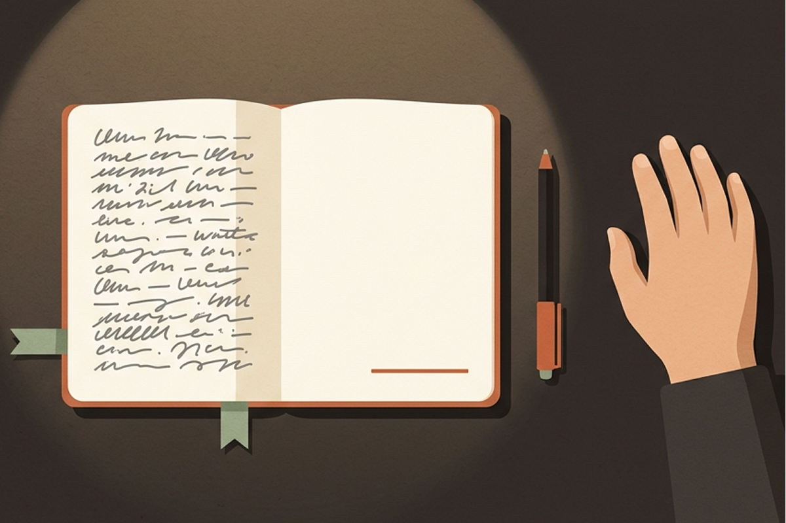
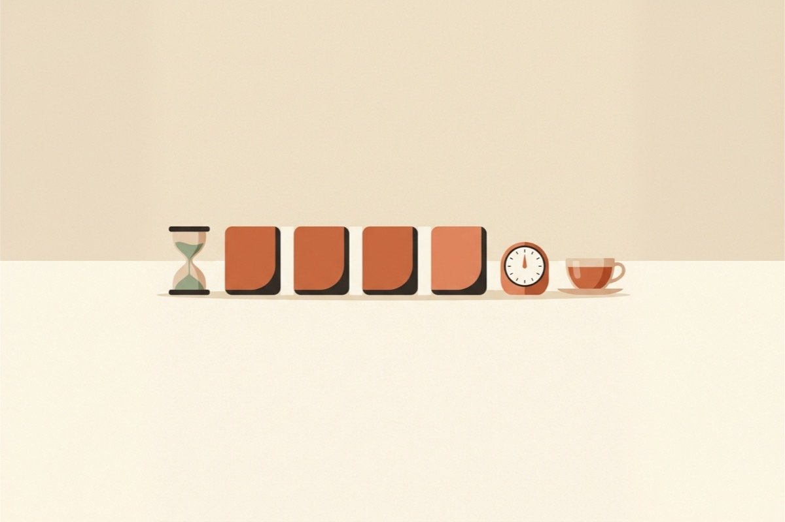

 Temps de lecture : environ 220 mots par minute (approximatif, balisage compris). 


<header class="guide-hero">
  
<a href="/fr/insights.html">← Toutes les perspectives</a>

  Perspectives Glit · Habitudes d'écriture
  <h1 class="guide-hero__title">{{ page.title }}</h1>
  

    <i class="far fa-calendar" aria-hidden="true"></i><time datetime="{{ page.date | date: '%Y-%m-%d' }}">{{ page.date | date: '%d/%m/%Y' }}</time>
    <i class="far fa-clock" aria-hidden="true"></i>Lecture : environ {{ read_min }} min
  

  
Les auteurs de romans en ligne qui tiennent le rythme d'une publication quotidienne n'ont pas une volonté hors du commun. Ils ont simplement réduit l'effort nécessaire pour se mettre à écrire et balisé à l'avance le chemin jusqu'à la fin de l'épisode. Voici <strong>cinq habitudes qui aident à aller au bout de chaque épisode</strong>.

  <nav class="section-nav" aria-label="Aller à la section">
    <a href="#summary">L'essentiel</a>
    <a href="#habit-1">1. La première phrase</a>
    <a href="#habit-2">2. Trois lignes</a>
    <a href="#habit-3">3. Des blocs de temps</a>
    <a href="#habit-4">4. Notes à portée de main</a>
    <a href="#habit-5">5. L'écran du lecteur</a>
    <a href="#stuck">Jours de blocage</a>
    <a href="#faq">Questions fréquentes</a>
  </nav>
</header>

<figure class="insight-figure insight-figure--cover">
  
</figure>

<section class="insight-summary" id="summary" aria-label="L'essentiel">
  L'essentiel
  <ol>
    <li><strong>En terminant l'épisode du jour, écrivez déjà la première phrase du suivant.</strong> Demain, au lieu d'une page blanche, vous trouverez une phrase prête à être poursuivie.</li>
    <li><strong>Avant d'écrire, posez vos scènes en trois lignes.</strong> Début, tournant, fin : avec ces trois scènes en tête, vous ne vous perdrez pas.</li>
    <li><strong>Raisonnez en temps, pas en nombre de mots.</strong> Il est bien plus facile de se lancer avec « quatre sessions de 25 minutes » qu'avec « 2 500 mots à écrire ».</li>
    <li><strong>Gardez vos notes d'univers juste à côté du manuscrit.</strong> Il suffit de changer de fenêtre pour retrouver un nom, et vous perdez le fil.</li>
    <li><strong>Relisez sur l'écran de vos lecteurs.</strong> C'est en lisant avec leurs yeux que l'on juge vraiment la longueur des paragraphes et les retours à la ligne.</li>
  </ol>
</section>

## Pourquoi écrire chaque jour est difficile {#why}

Tenir un feuilleton en ligne tient moins du marathon que du trajet quotidien pour aller au travail. Plutôt qu'un gros effort ponctuel, l'important est de répéter chaque jour la même tâche au prix d'un effort à peu près constant.

Beaucoup d'auteurs de romans en ligne s'en tiennent à des épisodes de 2 000 à 3 000 mots environ. Publier chaque jour, c'est donc écrire 60 000 à 90 000 mots par mois. Compter sur la seule volonté pour abattre un tel volume ne mène pas bien loin.

> Ce qui fait dérailler l'écriture quotidienne, c'est moins le « je n'ai pas envie » que l'accumulation de petites frictions.

Ne pas savoir par où commencer. Devoir s'interrompre en pleine écriture pour retrouver un détail de son univers. Un objectif de mots dont on ne voit pas le bout. Les cinq habitudes qui suivent sont autant de façons d'éliminer ces frictions, une à une.

Habitude 1

## Terminer en laissant la première phrase de l'épisode suivant {#habit-1}

La phrase la plus difficile de la journée, c'est la première. Alors, quand vous bouclez l'épisode du jour, **écrivez déjà une ou deux lignes du début du suivant** avant de vous arrêter.

<figure class="insight-figure">
  
</figure>

L'idéal est de vous interrompre en pleine montée de tension. Demain, en ouvrant le manuscrit, vous trouverez une phrase prête à être poursuivie, et la scène de la veille vous reviendra sans effort.

Cette méthode se marie très bien avec le cliffhanger de fin d'épisode. Si vous coupez l'épisode au moment où le lecteur brûle de connaître la suite, la première phrase de l'épisode suivant devient la première réponse à cette curiosité. Souvenez-vous : la phrase qui pousse le lecteur à cliquer sur « épisode suivant » est aussi celle qui vous donnera une raison de vous remettre à votre bureau le lendemain.

Pour voir plus en détail comment travailler la dernière phrase d'un épisode afin qu'elle mène au suivant, consultez le principe 5 de [Le premier épisode d'un roman en ligne : 5 principes pour donner envie de lire la suite](/fr/insights/first-chapter.html#rule-5).

Habitude 2

## Poser ses scènes en trois lignes avant d'écrire {#habit-2}

Si vous n'avez pas encore l'habitude de préparer vos intrigues, ne vous lancez pas tête baissée dans un plan détaillé qui vous ferait perdre du temps. Notez simplement ces trois lignes avant de commencer.

<figure class="insight-figure">
  
</figure>

  

    <h3>Scène d'ouverture</h3>
    
En une ligne : où s'ouvre l'épisode, et sur quelle action de quel personnage.

  

  

    <h3>Tournant</h3>
    
Ce qui change au milieu de l'épisode : un nouveau personnage, une nouvelle information ou un retournement de situation. Un seul de ces éléments suffit.

  

  

    <h3>Scène finale</h3>
    
Notez la dernière scène, celle qui donnera envie au lecteur d'ouvrir l'épisode suivant.

  

Avec ces trois lignes, écrire l'épisode ne consiste plus à « remplir 2 500 mots », mais à « relier trois points ». Même si vous bloquez en route, vous savez quel est le prochain point à atteindre et pouvez reprendre le fil.

Vous pouvez laisser ces trois lignes en haut du manuscrit et les effacer une fois l'épisode terminé, ou bien les rassembler épisode par épisode dans une note à part : elles vous serviront plus tard à résumer votre intrigue.

Habitude 3

## Découper l'objectif en blocs de temps {#habit-3}

Un objectif comme « 2 500 mots aujourd'hui » peut peser lourd avant même qu'on s'y mette. Découpez ce même objectif **en blocs de temps**, et le premier pas devient bien plus facile. Par exemple, quatre cycles de 25 minutes de concentration suivies de 5 minutes de pause donnent un rythme qui permet de boucler un épisode en un peu plus de deux heures.

<figure class="insight-figure">
  
</figure>

Dans ce découpage, l'essentiel est que la pause reste une vraie pause. Si vous continuez à retoucher votre texte pendant la pause, la session suivante perd de son mordant. Pendant les sessions de concentration, ne revenez pas sur les phrases déjà écrites : avancez. Les corrections attendront le moment de la relecture.

N'importe quel minuteur fait l'affaire ; celui du téléphone suffit largement. L'important, c'est qu'au moment où vous le lancez, vous vous envoyiez un signal : « maintenant, j'écris ». Si vous débutez, commencez par des cycles courts, par exemple 15 minutes de concentration et 3 minutes de pause, puis trouvez peu à peu votre propre rythme.

Habitude 4

## Garder ses notes d'univers juste à côté du manuscrit {#habit-4}

À mesure que le feuilleton s'allonge, personnages, lieux, factions et termes se comptent par dizaines. Dès que vous ouvrez une autre application ou un autre fichier pour vérifier le nom d'un personnage secondaire ou d'une technique, le rythme de la phrase en cours se brise. Et une fois revenu au texte, il faut du temps pour retrouver l'élan d'il y a un instant.

<figure class="insight-figure">
  
</figure>

Placez vos notes **à portée immédiate de l'écran où vous écrivez**. Quand un nouvel élément apparaît, notez-le sur-le-champ, puis mettez de l'ordre dans le tout une fois l'épisode terminé. Pendant l'écriture, l'objectif est de réduire au maximum le temps passé à « chercher ».

Inutile de viser une présentation parfaite. Une simple note à côté du manuscrit, divisée en personnages, lieux et termes, suffit amplement. En plein épisode, une note visible d'un simple coup d'œil est plus utile qu'une bible d'univers impeccablement organisée.

Habitude 5

## Relire sur l'écran de ses lecteurs {#habit-5}

La plupart des lecteurs de romans en ligne lisent sur leur téléphone. Un paragraphe qui paraissait raisonnable sur un grand moniteur peut devenir, sur mobile, un véritable mur de texte qui occupe tout l'écran. L'espacement entre dialogues et narration, l'endroit où couper les paragraphes, l'endroit où tombe la dernière ligne de l'épisode à l'écran : tout cela ne se voit vraiment qu'en **lisant à la largeur d'écran de vos lecteurs**.

<figure class="insight-figure">
  
</figure>

Mieux vaut relire un autre jour que celui où vous avez écrit, ou du moins à un autre moment. Un texte tout juste écrit se confond encore avec ce que vous aviez en tête, si bien que ses manques vous échappent. Organisez vos journées ainsi : relire l'épisode de la veille, puis écrire le nouveau. Vous tiendrez un rythme où, chaque jour, un épisode s'écrit et un autre se peaufine.

Le plus simple est de transférer le manuscrit sur votre téléphone et de le lire vous-même. Si un paragraphe dépasse la moitié de l'écran, cherchez où le couper. Si, en lisant à voix haute, une phrase vous laisse à bout de souffle, retravaillez-la. Une bonne relecture se fait avec les yeux du lecteur.

## Petits remèdes pour les jours de blocage {#stuck}

Même avec ces habitudes, il y aura des jours où rien ne vient. Ces jours-là, revoyez l'objectif à la baisse, mais ne vous arrêtez pas.

  

    <h3>Écrire 15 minutes seulement</h3>
    
Au lieu de viser la fin de l'épisode, autorisez-vous à vous lever après 15 minutes. Une fois lancé, on écrit souvent plus longtemps que prévu.

  

  

    <h3>Commencer par les scènes faciles</h3>
    
Rien n'oblige à écrire l'épisode dans l'ordre. Commencez par une scène tout en dialogues ou par une scène que vous voyez déjà nettement, et reliez le tout ensuite.

  

  

    <h3>Relire les derniers épisodes</h3>
    
Relire d'une traite les deux ou trois épisodes précédents ravive la voix des personnages et l'atmosphère des scènes : la phrase suivante vient alors plus facilement.

  

  

    <h3>Se constituer des épisodes d'avance</h3>
    
Les jours où l'écriture coule, écrivez un épisode de plus. Les jours de blocage, vous pourrez tenir votre rythme de publication tout en reprenant votre souffle.

  

## Questions fréquentes {#faq}

### Quelle longueur pour un épisode de roman en ligne ?

Cela dépend de la plateforme et du genre, mais beaucoup d'auteurs visent des épisodes de 2 000 à 3 000 mots. Prenez ce repère comme point de départ, et terminez chaque épisode là où la scène se referme naturellement plutôt qu'à un nombre de mots précis.

### Que faire si publier chaque jour devient trop lourd ?

Constituez-vous des épisodes d'avance en écrivant un épisode de plus les jours où tout coule. Les jours de blocage, revoyez l'objectif à la baisse, par exemple 15 minutes d'écriture : le feuilleton continue d'avancer sans que vous vous épuisiez.

### Faut-il un plan complet avant de commencer ?

Non. Vous pouvez commencer sans plan détaillé. Noter trois lignes par épisode, le début, le tournant et la fin, suffit pour ne pas vous perdre en chemin.

## Pour conclure {#closing}

Publier chaque jour est une affaire de répétition plus que de talent. Et la répétition devient plus facile à mesure qu'on réduit les frictions. Commencez par laisser la première phrase de l'épisode suivant en terminant celui du jour. Savoir que la première phrase de demain vous attend déjà suffit à rendre le retour au bureau bien plus léger.

Un dernier mot : en concevant Glit, nous y avons intégré un minuteur de concentration, un espace pour ranger vos notes d'univers à côté du manuscrit et un aperçu mobile, afin que ces habitudes soient un peu moins difficiles à tenir. Pour voir comment tout cela fonctionne, faites un tour dans les <a href="/fr/guide.html">guides</a>.

<a href="/fr/insights.html">← D'autres perspectives</a>

