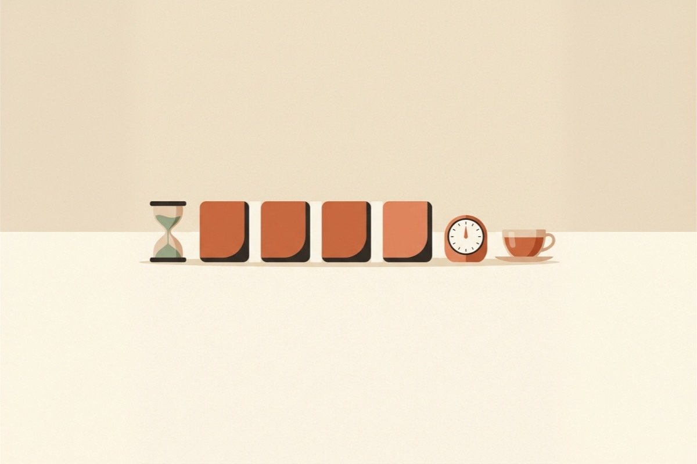

 読了時間: 日本語で1分あたり約500字(マークアップ込みの概算)。 


<header class="guide-hero">
  
<a href="/ja/insights.html">← インサイト一覧</a>

  Glit インサイト · 執筆習慣
  <h1 class="guide-hero__title">{{ page.title }}</h1>
  

    <i class="far fa-calendar" aria-hidden="true"></i><time datetime="{{ page.date | date: '%Y-%m-%d' }}">{{ page.date | date: '%Y年%-m月%-d日' }}</time>
    <i class="far fa-clock" aria-hidden="true"></i>読了時間 約{{ read_min }}分
  

  
Web小説の毎日更新を続けている書き手は、特別に意志が強いわけではありません。書き始めるハードルを下げ、最後までたどり着く道筋をあらかじめ整えている人たちです。この記事では、<strong>1話を最後まで書き切るための5つの習慣</strong>をまとめます。

  <nav class="section-nav" aria-label="記事内リンク">
    <a href="#summary">要点まとめ</a>
    <a href="#habit-1">1. 書き出しを残す</a>
    <a href="#habit-2">2. 場面を3行で</a>
    <a href="#habit-3">3. 時間で区切る</a>
    <a href="#habit-4">4. 設定は手元に</a>
    <a href="#habit-5">5. 読者の画面で推敲</a>
    <a href="#stuck">手が止まる日</a>
    <a href="#faq">よくある質問</a>
  </nav>
</header>

<figure class="insight-figure insight-figure--cover">
  
</figure>

<section class="insight-summary" id="summary" aria-label="要点まとめ">
  要点まとめ
  <ol>
    <li><strong>今日の話を書き終えるときに、次の話の書き出しを先に書いておきます。</strong>明日の自分は真っ白な画面ではなく、続きの一文を見ながらそのまま書き進められます。</li>
    <li><strong>書く前に、場面を3行で決めます。</strong>始まり・転換・終わりの3つの場面を決めておくだけで、途中で迷わなくなります。</li>
    <li><strong>文字数は時間で区切ります。</strong>「3,000字書く」より「25分ずつ4回書く」のほうが、ずっと書き始めやすくなります。</li>
    <li><strong>設定資料は原稿のすぐ横に置きます。</strong>名前ひとつを探してウィンドウを行き来した瞬間、流れが途切れます。</li>
    <li><strong>推敲は読者が見る画面で行います。</strong>読者の目線で読んでこそ、段落の長さや改行の良し悪しがきちんと見えてきます。</li>
  </ol>
</section>

## なぜ毎日書くのは難しいのか {#why}

Web小説の連載は、マラソンよりも毎日の通勤に近いものです。一度に大きな力を出すことより、同じ作業を毎日ほぼ同じ負担で繰り返すことが大切です。

毎日更新の場合、1話あたり2,000〜3,000字がひとつの目安とよく言われます。毎日書けば、ひと月で6万〜9万字を書くことになります。この量を意志の力だけで埋めようとしても、長くは続きません。

> 毎日の執筆を途切れさせるのは、「書きたくない」という気持ちよりも、積み重なっていく小さな摩擦です。

どこから書けばいいかわからない状態。書いている途中で設定を探して手が止まる瞬間。終わりの見えない文字数。次の5つの習慣は、こうした摩擦をひとつずつ取り除く方法です。

習慣 1

## 次の話の書き出しを残して終える {#habit-1}

一日のうちでいちばん書きにくいのは、最初の一文です。だからこそ、今日の話を書き終えるときに、**次の話の書き出しを1〜2行先に書いてから**終えましょう。

<figure class="insight-figure">
  
</figure>

場面が盛り上がっている途中で止めると、なおよいでしょう。翌日原稿を開いたときには続きの一文がもう用意されていて、昨日の場面がすぐに頭に浮かびます。

この方法は、話の終わりの「引き」とも相性がよいです。気になるところで話を切っていれば、次の話の書き出しは、その引きに対する最初の反応になります。読者に次の話を開かせる一文が、書き手にとっても翌日また机に向かう理由になる。そのことを覚えておいてください。

話の最後の一文を次の話につながるように整える方法は、[Web小説の1話目の書き方：読者が次の話を読みたくなる5つの原則](/ja/insights/first-chapter.html#rule-5)の原則 5 で詳しく紹介しています。

習慣 2

## 書く前に、場面を3行で決める {#habit-2}

プロット作りにまだ慣れていないなら、いきなり細かいプロットを作り込もうとして時間を費やさないでください。書く前に、次の3行だけ書き留めておけば十分です。

<figure class="insight-figure">
  
</figure>

  

    <h3>始まりの場面</h3>
    
その話がどこで、誰のどんな行動から始まるのかを1行で書きます。

  

  

    <h3>転換</h3>
    
話の途中で変わることをひとつ。新しい人物、新しい情報、状況の逆転のどれかひとつで十分です。

  

  

    <h3>終わりの場面</h3>
    
読者に次の話を開かせる、最後の場面を書きます。

  

この3行があれば、1話は「3,000字を埋める作業」から「3つの地点をつなぐ作業」に変わります。途中で詰まっても、次の地点がどこかわかっているので、また書き進められます。

3行は原稿の冒頭に書いておき、書き終えたら消してもかまいません。別のメモに話ごとにまとめておけば、あとであらすじの整理にも使えます。

習慣 3

## 文字数を時間で区切る {#habit-3}

「今日は3,000字」という目標は、書き始める前から負担になることがあります。同じ目標を**時間単位で区切ると**、最初の一歩がずっと踏み出しやすくなります。たとえば25分集中・5分休憩を4回繰り返せば、2時間あまりで1話を書き終えられるリズムになります。

<figure class="insight-figure">
  
</figure>

時間を区切るときにいちばん大切なのは、休憩はきちんと休憩だけにあてることです。休んでいる間も原稿を直し続けると、次の集中が鈍ってしまいます。集中時間には前の文に戻って直さず、そのまま書き進めてください。文章の手直しは推敲の時間に回しましょう。

タイマーは何でもかまいません。スマートフォンのタイマーで十分です。大切なのは、スタートを押した瞬間に「今は書く時間だ」という合図を自分に送ることです。慣れないうちは15分集中・3分休憩のように短めに始めて、自分なりのルーティンを少しずつ見つけていきましょう。

習慣 4

## 設定資料は原稿のすぐ横に置く {#habit-4}

連載が長くなると、登場人物、地名、勢力、用語が数十個に増えていきます。脇役の名前や技名ひとつを確かめようとほかのアプリやファイルを開いた瞬間、書いていた文のリズムが途切れます。戻ってきても、さっきまでの感覚を取り戻すのに時間がかかります。

<figure class="insight-figure">
  
</figure>

設定資料は、**原稿を書いている画面からすぐ手の届くところ**に置きましょう。新しい設定が生まれたらその場ですぐ書き留め、1話を書き終えてからまとめて整理します。書いている間は「探す作業」をできるだけ減らすのが目標です。

形式を完璧に整える必要はありません。原稿の横に設定メモをひとつ置いて、人物・場所・用語くらいに分けておくだけで十分です。きれいにまとまった設定集よりも、ちょっと目をやれば見えるメモのほうが、書いている最中には役に立ちます。

習慣 5

## 推敲は読者が見る画面で行う {#habit-5}

Web小説の読者の多くはスマートフォンで読んでいます。広いモニターではちょうどよく見えた段落が、スマートフォンでは画面いっぱいの文字の壁に見えることもあります。台詞と地の文の間隔、段落を切る位置、話の最後の一行が画面のどのあたりで終わるかは、**読者の画面の幅で読んでみて**はじめてきちんと見えてきます。

<figure class="insight-figure">
  
</figure>

推敲は書いた日とは別の日、せめて時間を置いてから行うのがおすすめです。書いたばかりの文章は頭の中の意図と重なって見えるので、抜けている部分に気づきにくいのです。今日は昨日書いた話を推敲し、新しい話を書く。そんなふうに一日を組み立てれば、毎日1話ずつ書くことと磨くことを無理なく両立できます。

いちばん簡単な方法は、原稿をスマートフォンに移して実際に読んでみることです。ひとつの段落が画面の半分を超えるようなら、分けられる位置がないか見直してください。声に出して読んで息が続かない文があれば、ほどよく整えましょう。よい推敲は、読者の目線で磨くものです。

## 手が止まる日のための短い処方箋 {#stuck}

習慣を身につけても、手が動かない日は来ます。そんな日は目標を下げてもかまいません。ただ、書くこと自体はやめないでください。

  

    <h3>15分だけ書く</h3>
    
1話を書き終えようと考える代わりに、15分書いたら席を立ってもいいと決めます。書き始めれば、思ったより長く書ける日も多いものです。

  

  

    <h3>書きやすい場面から</h3>
    
1話を順番どおりに書く必要はありません。台詞だけの場面や、もう頭に浮かんでいる場面から書いて、あとでつなげます。

  

  

    <h3>前の話を読み返す</h3>
    
直前の2〜3話を続けて読むと、登場人物の口調や場面の空気感がよみがえり、次の一文が出てきやすくなります。

  

  

    <h3>書き溜めを作る</h3>
    
筆が乗る日にもう1話書いておけば、手が止まる日でも更新を途切れさせずにひと息つけます。

  

## よくある質問 {#faq}

### Web小説の1話の文字数はどれくらいですか？

サイトやジャンルによって違いますが、毎日更新なら1話2,000〜3,000字ほどがよく目安にされます。まずはこの範囲を目安にしつつ、文字数ぴったりよりも場面が自然に区切れるところで話を終えることを優先しましょう。

### 毎日更新がつらいときはどうすればいいですか？

筆が乗る日にもう1話書いて、書き溜めを作っておきましょう。書けない日は「15分だけ書く」のように目標を下げれば、更新を途切れさせずに続けられます。

### 書く前にプロットは必ず作るべきですか？

細かいプロットがなくても書き始められます。1話ごとに始まり・転換・終わりの3行を決めておくだけで、途中で迷わなくなります。

## おわりに {#closing}

毎日更新は、才能よりも繰り返しの問題です。そして繰り返しは、摩擦を減らすほど楽になります。今日の話を書き終えるときに、次の話の書き出しを残すことから始めてみてください。明日の最初の一文がもう用意されている。それだけで、机に向かう気持ちがずっと軽くなります。

ちなみに、私たちは Glit を作るにあたって、こうした習慣を少しでも楽に続けられるよう、集中タイマー、原稿のすぐ隣での設定整理、モバイル幅のプレビューを取り入れました。使い方が気になったら、<a href="/ja/guide.html">ガイド</a>をのぞいてみてください。

<a href="/ja/insights.html">← ほかのインサイトを読む</a>

