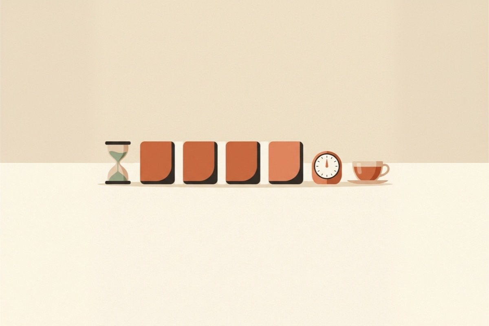

 읽는 시간: 한국어 기준 1분에 약 550자(마크업 포함 근사치). 


<header class="guide-hero">
  
<a href="/ko/insights.html">← 인사이트 목록</a>

  글릿 인사이트 · 집필 습관
  <h1 class="guide-hero__title">{{ page.title }}</h1>
  

    <i class="far fa-calendar" aria-hidden="true"></i><time datetime="{{ page.date | date: '%Y-%m-%d' }}">{{ page.date | date: '%Y.%m.%d' }}</time>
    <i class="far fa-clock" aria-hidden="true"></i>읽는 시간 약 {{ read_min }}분
  

  
웹소설을 매일 연재하는 작가들은 의지가 특별히 강한 사람이 아닙니다. 쓰기 시작하는 데 드는 힘을 줄이고, 끝까지 가는 길을 미리 깔아 둔 사람들입니다. 이 글은 <strong>한 회차를 끝까지 쓰게 만드는 다섯 가지 습관</strong>을 정리합니다.

  <nav class="section-nav" aria-label="글 바로가기">
    <a href="#summary">핵심 요약</a>
    <a href="#habit-1">1. 첫 문장 남기기</a>
    <a href="#habit-2">2. 장면 세 줄</a>
    <a href="#habit-3">3. 시간으로 나누기</a>
    <a href="#habit-4">4. 설정은 옆에</a>
    <a href="#habit-5">5. 독자 화면으로 퇴고</a>
    <a href="#stuck">막히는 날</a>
    <a href="#faq">자주 묻는 질문</a>
  </nav>
</header>

<figure class="insight-figure insight-figure--cover">
  
</figure>

<section class="insight-summary" id="summary" aria-label="핵심 요약">
  핵심 요약
  <ol>
    <li><strong>오늘 회차를 끝낼 때 다음 회차의 첫 문장을 미리 써 둡니다.</strong> 내일의 나는 빈 화면이 아니라 이어 쓸 문장을 보며 이어서 글을 씁니다.</li>
    <li><strong>쓰기 전에 장면을 세 줄로 정합니다.</strong> 시작, 전환, 끝 이렇게 3개 장면만 정해도 길을 잃지 않습니다.</li>
    <li><strong>분량은 시간으로 나눕니다.</strong> "5,000자를 쓴다"보다 "25분씩 네 번 쓴다"가 시작하기 훨씬 쉽습니다.</li>
    <li><strong>설정 자료는 원고 바로 옆에 둡니다.</strong> 이름 하나를 찾으려고 창을 오가는 순간 흐름이 끊깁니다.</li>
    <li><strong>퇴고는 독자가 보는 화면에서 합니다.</strong> 독자의 시선으로 읽어야 문단 길이와 줄바꿈이 제대로 보입니다.</li>
  </ol>
</section>

## 왜 매일 쓰기가 어려운가 {#why}

웹소설 연재는 마라톤보다 출퇴근에 가깝습니다. 한 번 크게 힘을 내는 것보다, 같은 일을 매일 비슷한 비용으로 반복하는 것이 중요합니다.

많은 플랫폼에서 한 화 분량을 공백 포함 5,000자 안팎으로 맞추는 만큼, 매일 연재한다면 한 달에 15만 자 가까이 쓰게 됩니다. 이 분량을 의지만으로 채우려 하면 오래가지 못합니다.

> 매일 쓰기를 무너뜨리는 것은 "쓰기 싫다"는 마음보다, 쌓여 가는 작은 마찰들입니다.

어디서부터 써야 할지 모르는 상태, 쓰다가 설정을 찾느라 멈추는 순간, 끝이 보이지 않는 분량. 아래 다섯 가지 습관은 이 마찰을 하나씩 없애는 방법입니다.

습관 1

## 다음 회차의 첫 문장을 남기고 끝내기 {#habit-1}

하루 중 가장 쓰기 힘든 문장은 첫 문장입니다. 그래서 오늘 회차를 마칠 때 **다음 회차의 첫 문장 한두 줄을 미리 써 두고** 끝내세요.

<figure class="insight-figure">
  
</figure>

장면이 한창 달아오른 지점에서 멈추면 더 좋습니다. 내일 원고를 열었을 때 이미 이어 쓸 문장이 준비되어 있고, 머릿속에는 어제의 그 장면이 쉽게 그려집니다.

이 방법은 회차 끝의 절단신공과도 잘 맞습니다. 회차를 궁금한 지점에서 끊었다면, 다음 회차의 첫 문장은 그 궁금증에 대한 첫 반응이 됩니다. 독자가 다음 화를 누르게 만드는 문장이 작가에게도 다음 날 책상에 앉을 이유라는 것을 기억하세요.

회차의 마지막 줄을 다음 화로 이어지게 다듬는 방법은 [웹소설 1화, 독자가 다음 화를 클릭하게 만드는 5가지 원칙](/ko/insights/first-chapter.html#rule-5)의 원칙 5에서 더 자세히 다룹니다.

습관 2

## 쓰기 전에 장면을 세 줄로 정하기 {#habit-2}

플롯 준비가 익숙하지 않다면 섣불리 자세한 플롯에 시간을 허비하지 마세요. 쓰기 전에 아래 세 줄만 적어 두시면 됩니다.

<figure class="insight-figure">
  
</figure>

  

    <h3>시작 장면</h3>
    
회차가 어디서, 누구의 어떤 행동으로 시작하는지 한 줄로 적습니다.

  

  

    <h3>전환</h3>
    
회차 가운데에서 바뀌는 것 하나. 새 인물, 새 정보, 뒤집히는 상황 중 하나면 충분합니다.

  

  

    <h3>끝 장면</h3>
    
독자가 다음 화를 누르게 만들 마지막 장면을 적습니다.

  

세 줄이 있으면 회차는 "5,000자를 채우는 일"에서 "세 지점을 잇는 일"로 변합니다. 중간에서 막혀도 다음 지점이 어디인지 알기 때문에 다시 이어갈 수 있습니다.

세 줄은 원고 맨 위에 적어 두었다가 다 쓴 뒤 지우거나, 별도 노트에 회차별로 모아 두면 나중에 줄거리 정리용으로도 쓸 수 있습니다.

습관 3

## 분량을 시간으로 나누기 {#habit-3}

"오늘 5,000자"라는 목표는 시작 전에 부담이 될 수 있습니다. 같은 목표를 **시간 단위로 나누면** 첫 단추를 끼우기가 훨씬 쉬워집니다. 예를 들어 25분 집중, 5분 휴식을 네 번 반복하면 두 시간 남짓 안에 한 회차를 마칠 수 있는 리듬이 됩니다.

<figure class="insight-figure">
  
</figure>

시간을 나눌 때 가장 중요한 것은 휴식을 온전히 휴식으로만 사용하는 것입니다. 쉬는 동안 원고를 계속 고치면 다음 집중 시간이 무뎌집니다. 집중 시간에는 앞 문장을 다시 고치지 말고 이어서 쓰세요. 문장을 고치는 일은 퇴고 시간에 하실 수 있습니다.

타이머는 무엇이든 괜찮습니다. 휴대폰 타이머로도 충분합니다. 중요한 것은 시작을 누르는 순간 스스로에게 "지금은 쓰는 시간"이라는 신호를 주는 것입니다. 처음이라면 15분 집중, 3분 휴식처럼 짧게 시작해서 자신만의 루틴을 천천히 찾으세요.

습관 4

## 설정 자료는 원고 바로 옆에 두기 {#habit-4}

연재가 길어지면 인물, 지명, 세력, 용어가 수십 개로 늘어납니다. 조연의 이름이나 기술 이름 하나를 확인하려고 다른 앱이나 파일을 들여다보는 순간, 쓰고 있던 문장의 리듬이 끊어집니다. 다시 돌아와도 방금까지의 감각을 되찾는 데 시간이 걸립니다.

<figure class="insight-figure">
  
</figure>

설정 자료는 **원고를 쓰는 화면에서 한 번에 닿는 거리**에 두세요. 새 설정이 생기면 그 자리에서 바로 적고, 회차를 다 쓴 뒤 한꺼번에 정리합니다. 쓰는 중에는 "찾는 일"을 최대한 줄이는 것이 목표입니다.

형식을 완벽하게 갖출 필요는 없습니다. 원고 옆에 설정 메모 하나를 두고 인물, 장소, 용어 정도로만 나눠 두어도 충분합니다. 잘 정리된 설정집보다 고개만 돌리면 보이는 메모가 쓰는 중에는 더 쓸모 있습니다.

습관 5

## 퇴고는 독자가 보는 화면에서 하기 {#habit-5}

웹소설 독자 대부분은 휴대폰으로 읽습니다. 넓은 모니터에서는 적당해 보이던 문단이 모바일 화면에서는 한 화면을 꽉 채우는 벽처럼 보이기도 합니다. 대사와 지문의 간격, 문단을 끊는 위치, 회차 마지막 줄이 화면 어디쯤에서 끝나는지는 **독자의 화면 너비로 읽어 봐야** 제대로 보입니다.

<figure class="insight-figure">
  
</figure>

퇴고는 쓰기와 다른 날, 적어도 다른 시간에 하는 편이 좋습니다. 막 쓴 문장은 머릿속 의도와 겹쳐 보여서 빈 곳이 잘 보이지 않습니다. 오늘은 어제 쓴 회차를 퇴고하고 새 회차를 쓰는 식으로 하루를 짜면, 매일 한 회차씩 쓰고 다듬는 흐름을 함께 유지할 수 있습니다.

가장 간단한 방법은 원고를 휴대폰으로 옮겨 직접 읽어 보는 것입니다. 한 문단이 휴대폰 화면의 절반을 넘긴다면 나눌 위치가 없는지 살펴보세요. 소리 내어 읽다가 숨이 차는 문장이 있다면 적절히 다듬어 주세요. 좋은 퇴고는 독자의 시선으로 다듬습니다.

## 막히는 날을 위한 짧은 처방 {#stuck}

습관을 갖춰도 손이 움직이지 않는 날은 옵니다. 그런 날에는 목표를 낮추되, 멈추지는 마세요.

  

    <h3>15분만 쓰기</h3>
    
회차를 끝내겠다는 생각 대신 15분만 쓰고 일어나도 된다고 정합니다. 시작하고 나면 생각보다 오래 쓰는 날이 많습니다.

  

  

    <h3>쉬운 장면부터</h3>
    
회차를 순서대로 쓸 필요는 없습니다. 대사만 있는 장면, 이미 머릿속에 그려진 장면부터 쓰고 나중에 잇습니다.

  

  

    <h3>지난 회차 다시 읽기</h3>
    
직전 두세 화를 이어 읽으면 인물의 말투와 장면의 온도가 되살아나 다음 문장이 나오기 쉬워집니다.

  

  

    <h3>비축분 만들기</h3>
    
잘 써지는 날 한 회차를 더 써 두면, 막히는 날에도 연재를 지키면서 숨을 고를 수 있습니다.

  

## 자주 묻는 질문 {#faq}

### 웹소설 한 화 분량은 얼마나 되나요?

플랫폼과 장르마다 다르지만, 국내 유료 연재에서는 공백 포함 5,000자 안팎을 한 화 기준으로 삼는 경우가 많습니다. 처음에는 이 기준에 맞춰 쓰되, 글자 수보다 장면이 자연스럽게 끝나는 자리에서 끊는 것을 먼저 생각하세요.

### 매일 연재가 힘들 때는 어떻게 하나요?

잘 써지는 날 한 화를 더 써서 비축분을 만들어 두세요. 막히는 날에는 15분만 쓰기처럼 목표를 낮추면 연재를 멈추지 않고 이어 갈 수 있습니다.

### 웹소설을 쓰기 전에 플롯을 꼭 짜야 하나요?

자세한 플롯이 없어도 시작할 수 있습니다. 한 화마다 시작, 전환, 끝 장면 세 줄만 정해 두어도 중간에 길을 잃지 않습니다.

## 마치며 {#closing}

매일 연재는 재능보다 반복의 문제입니다. 그리고 반복은 마찰을 줄일수록 쉬워집니다. 오늘 회차를 끝낼 때 다음 회차의 첫 문장을 남기는 것부터 시작해 보세요. 내일의 첫 문장이 이미 준비되어 있다는 것만으로도 책상 앞에 앉기가 한결 가벼워집니다.

덧붙여, 저희는 Glit을 만들면서 이 습관들을 조금 덜 힘들게 지킬 수 있도록 집중 타이머, 원고 옆 설정 정리, 모바일 미리보기를 넣었습니다. 어떻게 쓰는지 궁금하다면 <a href="/ko/guide.html">가이드</a>에서 살펴보세요.

<a href="/ko/insights.html">← 다른 인사이트 보기</a>

