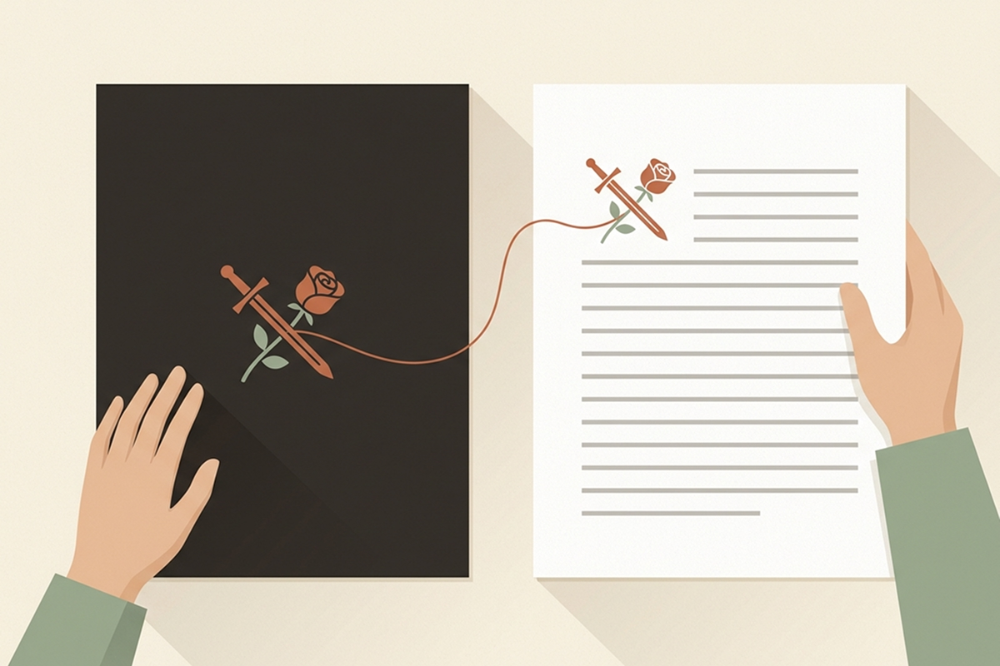

 阅读时间：中文按每分钟约500字估算（含标记，近似值）。 


<header class="guide-hero">
  
<a href="/zh/insights.html">← 洞察列表</a>

  Glit 洞察 · 写作技巧
  <h1 class="guide-hero__title">{{ page.title }}</h1>
  

    <i class="far fa-calendar" aria-hidden="true"></i><time datetime="{{ page.date | date: '%Y-%m-%d' }}">{{ page.date | date: '%Y年%-m月%-d日' }}</time>
    <i class="far fa-clock" aria-hidden="true"></i>阅读时间约 {{ read_min }} 分钟
  

  
开始读网文第一章的读者，最多几章之内就会决定要不要继续追下去。网文圈常说的“黄金三章”，指的正是这件事。也正因为如此，第一章往往是作者改得最多的一章。本文整理了<strong>让读者顺势点开下一章的 5 个开篇原则</strong>。

  <nav class="section-nav" aria-label="文章导航">
    <a href="#summary">要点速览</a>
    <a href="#rule-1">1. 用事件开场</a>
    <a href="#rule-2">2. 主角的困境</a>
    <a href="#rule-3">3. 立住题材</a>
    <a href="#rule-4">4. 只留一个问题</a>
    <a href="#rule-5">5. 最后一句</a>
    <a href="#check">写完后检查</a>
    <a href="#faq">常见问题</a>
  </nav>
</header>

<figure class="insight-figure insight-figure--cover">
  
</figure>

<section class="insight-summary" id="summary" aria-label="要点速览">
  要点速览
  <ol>
    <li><strong>第一幕用事件开场。</strong>世界观从第一个事件出发，一点点铺开就够了。</li>
    <li><strong>尽早亮出主角的困境，以及他可能失去的东西。</strong>第一页就让读者知道这是谁的故事，读者才容易跟上。</li>
    <li><strong>在第一页立住题材。</strong>让读者在第一章里就感受到书名和简介承诺的那种氛围。</li>
    <li><strong>只留一个问题，信息一点点放出来。</strong>悬念越少、越明确，读者越会惦记着下一章。</li>
    <li><strong>把第一章的最后一句打磨成第二章的开头。</strong>这一句就是推着读者点开下一章的动力。</li>
  </ol>
</section>

## 为什么网文第一章最难写 {#why}

读第一章的读者，对主角还一无所知。还没对主角产生感情，只要稍微有点无聊，就会顺手点“返回”。

作者的处境正好相反。写第一章的时候，正是最想把东西全摆出来的时候：精心搭建的世界观、主角的过去、后面剧情的伏笔，恨不得全都塞进第一章。

这两种处境一撞上，第一章的开头就会被大段说明填满。几乎每篇写作经验帖都会提到“开头先写设定，很容易卡住”，原因就在这里。

> 第一章是你和读者许下第一个承诺的地方。让读者看到，跟着这个故事走下去，会遇到什么。

下面这 5 个原则，讲的是第一章里该放什么、什么可以往后放。

原则 1

## 用事件开场，而不是用说明开场 {#rule-1}

如果第一章从背景介绍或主角的生平讲起，故事还没开始，读者就已经看累、走人了。第一幕要从**主角正在做某件事的那一刻**开始。打斗、逃跑，哪怕只是在和人吵架，都能让读者自然地入戏。

<figure class="insight-figure">
  
</figure>

如果找不到开场的切入点，可以想想日常撞上非日常的那一刻：平平常常的上班路上收到一条奇怪的短信，考试前一天眼前突然弹出系统面板，都是这样的场景。那一刻之前的事，也就是背景介绍和主角的生平，等以后需要的时候再自然地融进去就行。

世界观要通过事件一点点展现。与其把整个修炼体系或魔法体系讲一遍，不如只展示主角在这一幕里用到的那一招。读者看着规则在场景里真正派上用场，自然就能理解世界观，也会慢慢熟悉起来。

原则 2

## 尽早亮出主角的困境，以及他可能失去的东西 {#rule-2}

读者知道了主角想要什么，才会真正被故事抓住。最好在第一页，最晚也要在第一幕结束之前，让读者知道**主角是谁、他此刻想要什么、失败了会失去什么**。

<figure class="insight-figure">
  
</figure>

以重生文为例。光有“主角重生了”这一点，故事还转不起来。只有当第一幕同时让读者看到，主角这一世必须改变的事，以及这件事办不成就会失去的东西，读者才会站到主角这一边，跟着他往下走。

可能失去的东西不必惊天动地。一个拼命想守住今晚和妹妹之约的主角，同样能牢牢抓住读者的心。关键是让场景里透出主角有多在乎这件事。

原则 3

## 在第一页立住题材 {#rule-3}

读者是看了书名和简介才点开第一章的。如果读者是冲着西幻言情点进来的，第一页却是大段的战争描写，那么无论这一幕写得多好，读者都会觉得走错了地方，转身去找别的书。

<figure class="insight-figure">
  
</figure>

检查题材有没有立住，方法很简单：遮住书名和简介，看看**只读第一章的第一页，能不能猜出这是什么题材**。如果一下子看不出来，就把最能代表这个题材的一个元素放进第一幕里。

还要小心一种写法：把最精彩的场面挪到第一章开头，紧接着又回到节奏缓慢的日常。读者会默认第一幕的节奏和氛围会一直延续下去，到了第二章期待一落空，就会觉得自己被骗了。

原则 4

## 只留一个问题，信息一点点放 {#rule-4}

第一章里出场的人物、地名、专有名词越多，读者要记的东西就越多。除了主角，有名有姓地介绍的人物先控制在两三个。其他人用“守卫”“隔壁工位的同事”这样的身份来称呼就可以。

<figure class="insight-figure">
  
</figure>

留给读者的悬念也要收窄到一个。比如：这个人为什么被追杀？那天晚上发生了什么？那枚戒指又是什么？问题一次抛出太多，读者就不知道该跟哪条线了。把**最重要的那一个问题**清清楚楚地留下来，其余的分到第二章、第三章里去。

原则 5

## 把第一章的最后一句打磨成第二章的开头 {#rule-5}

第一章的最后一幕，与其停在事情了结的时候，不如断在**新的问题或选择刚刚出现的那一刻**。比如门被推开、一个陌生人走进来的瞬间，或者主角即将做出无法回头的决定之前。

<figure class="insight-figure">
  
</figure>

写完最后一句，单独把它读一遍。如果光凭这一句就想看下一章，这一章就断得好。

这样断章，写第二章时也会轻松很多，因为下一章的第一句自然就有了。可以和[网文日更：写完每一章的 5 个习惯](/zh/insights/daily-serial-habits.html#habit-1)里介绍的“写好下一章的第一句再收工”搭配着用。

## 写完第一章后要检查的事 {#check}

写完第一章后，像读者一样在手机上读一遍，顺便检查下面四点。

  

    <h3>第一段里有主角吗</h3>
    
检查主角是否在第一段就出场，或者至少场景是从主角的视角开始的。

  

  

    <h3>说明是不是太长了</h3>
    
如果纯说明的段落连着超过三段，就把一部分挪到后面的章节，或者改写成对话和动作。

  

  

    <h3>看得出题材吗</h3>
    
不看书名和简介，只读第一页，能不能猜出这是什么样的故事。

  

  

    <h3>有点开第二章的理由吗</h3>
    
只读最后一句，看看会不会想点开下一章。

  

## 常见问题 {#faq}

### 网文第一章里，世界观设定要写多少？

够读者看懂这一幕就行。只交代读者跟上主角眼下处境所必需的规则，其余的随着剧情推进，借事件慢慢交代。

### 可以用楔子开头吗？

可以。但楔子如果太长，或者和正文的氛围差别太大，真正的故事还没开始，读者可能就走了。要写楔子的话，就写得短一点，第一章一开头就直接切进主角的事件。

### 第一章什么时候修改比较好？

建议多写几章之后再回头修改。作者自己弄清楚故事要往哪里走之后，第一章该向读者承诺什么才会变得清楚。

## 写在最后 {#closing}

想把所有东西都塞进第一章，第一章就会变得沉重。能把读者带进第二章，第一章就已经完成了它的任务。开头用事件打开局面，最后一句朝着下一章敞开。中间的故事，从第二章开始慢慢讲也不迟。

顺带一提，我们在 Glit 里加入了读者视角预览，可以按读者手机屏幕的样子读一遍第一章；还加入了世界观树，方便把设定整理在稿子旁边。想知道具体怎么用，可以看看<a href="/zh/guide.html">使用指南</a>。

<a href="/zh/insights.html">← 阅读更多洞察</a>

